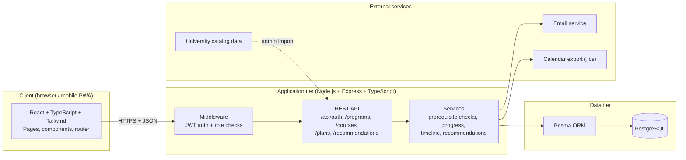
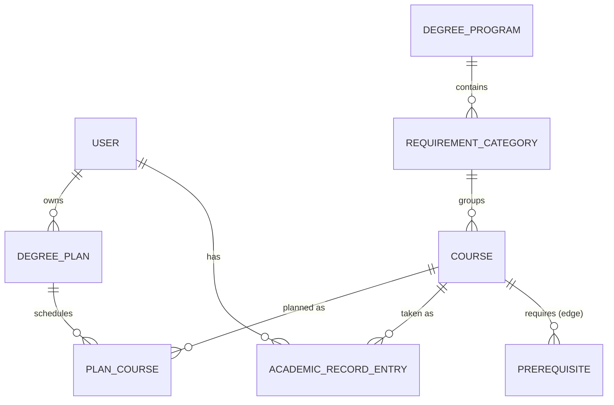

# Sync – System Architecture

This document finalizes the architecture for Sync, based on the requirements in `Sync_SRS_v1.0.docx` (Section 5). Sync is a three-tier web application: a React front end, a REST API back end, and a PostgreSQL database.

## 1. Overview



| Tier | Responsibility | Technology |
|---|---|---|
| Presentation | Screens, routing, form handling, visualizations | React, TypeScript, Tailwind CSS, Vite, React Router |
| Application | Business logic, authentication, authorization, validation | Node.js, Express, TypeScript, JWT, bcrypt, Zod |
| Data | Persistent storage of users, catalog, plans | PostgreSQL, Prisma ORM |

The front end and back end are separate apps. They communicate only through the REST API over HTTPS using JSON. Neither folder imports code from the other, so either side can be changed or replaced independently (for example, a native mobile app could reuse the same API).

## 2. Front end

```
frontend/src/
├── main.tsx            Entry point, mounts <App /> into #root
├── index.css           Tailwind import + theme colors (brand)
├── react/app.tsx       Router: maps each URL to a page
├── pages/              One file per screen (signinpage, dashboardpage, ...)
├── components/         Reusable pieces (navbar, ...)
└── test/setup.ts       Test environment setup
```

- **Routing:** React Router. `/login`, `/dashboard` are built; `/progress`, `/map`, `/plan`, `/recs`, `/timeline` currently show a "coming soon" page.
- **State:** local component state (`useState`) for now. Server data will be fetched through a shared API helper once the back end is connected.
- **Styling:** Tailwind CSS with a custom `brand` color defined in `index.css`.
- **Current data:** pages use hard-coded sample data. Each sample is marked to be replaced with an API call.

## 3. Back end

```
backend/src/
├── index.ts            Starts Express, registers routes and middleware
├── routes/             One file per feature area
│   ├── auth.routes.ts
│   ├── programs.routes.ts
│   ├── courses.routes.ts
│   ├── plans.routes.ts
│   └── recommendations.routes.ts
├── middleware/
│   └── auth.middleware.ts   Verifies JWT, enforces roles (student / advisor / admin)
└── services/           Business logic (prerequisite validation, progress, timeline)
```

Route handlers stay thin. They validate input, call a service, and return JSON. Logic such as prerequisite checking and graduation timeline calculation lives in `services/` so it can be unit tested without HTTP.

### Main API surface

| Method & path | Purpose | Requirement |
|---|---|---|
| `POST /api/auth/register`, `/login`, `/logout` | Account and session | FR-1 |
| `GET /api/programs`, `/programs/:id/requirements` | Degree programs and requirements | FR-2, FR-4 |
| `GET /api/courses`, `/courses/:id/prerequisites` | Search and dependency data | FR-5, FR-11 |
| `GET /api/plans/:studentId`, `POST /plans/:studentId/terms/:term/courses` | Degree plans | FR-6 |
| `GET /api/recommendations/:studentId` | Ranked next courses | FR-7 |

## 4. Database

PostgreSQL, managed through Prisma (`backend/prisma/schema.prisma`).



Course prerequisites are stored as edges in a `Prerequisite` table (course → required course), forming a directed graph. This supports the dependency map and lets the back end reject circular dependencies when catalog data changes.

## 5. Key flows

**Add a recommended course to a plan**
1. Student clicks "Add to plan" on the dashboard.
2. Front end sends `POST /api/plans/:studentId/terms/:term/courses`.
3. Auth middleware verifies the JWT and that the student owns this plan.
4. The plan service checks that all prerequisites are satisfied.
5. If valid, the course is saved and the updated plan returns; otherwise a conflict message returns.
6. Front end updates the dashboard and plan views.

## 6. Security

- HTTPS for all traffic between client and server.
- Passwords stored only as salted hashes (bcrypt).
- JWT for sessions; role-based access control (students see only their own data, advisors only data shared with them, admins only admin functions).
- Input validation on every route (Zod); Prisma's parameterized queries guard against SQL injection.
- Student data handled with FERPA in mind; no write access to university systems.

## 7. Testing

- **Tool:** Vitest with React Testing Library (jsdom). Run with `npm test` in `frontend/`.
- **Current tests:** dashboard "Add to plan" behavior, and sign-in page switching between Log In and Create Account.
- **Planned:** unit tests for back-end services (prerequisite validation, progress calculation), then API route tests.
- **CI:** GitHub Actions runs the build and tests on every push and pull request to `main` and `develop`.

## 8. Key decisions

| Decision | Reason |
|---|---|
| One repo, two apps (`frontend/`, `backend/`) | Simple for a four-person team; clear separation of concerns |
| TypeScript on both sides | One language across the stack; type errors caught early |
| PostgreSQL over a document database | Data is relational; prerequisites are graph edges with integrity rules |
| Prisma ORM | Type-safe queries and migrations |
| REST + JSON | Simple, well understood, reusable by a future mobile app |
| Catalog data stored in our own database | App keeps working if the university source is unavailable |
| Rule-based recommendations first | Predictable and explainable; can be improved later |

## 9. Current status

Front end: sign-in and dashboard built with sample data, tests added. Back end: route stubs return `501 Not Implemented`; Prisma schema defined. Next: connect auth end to end, then load real catalog data.
