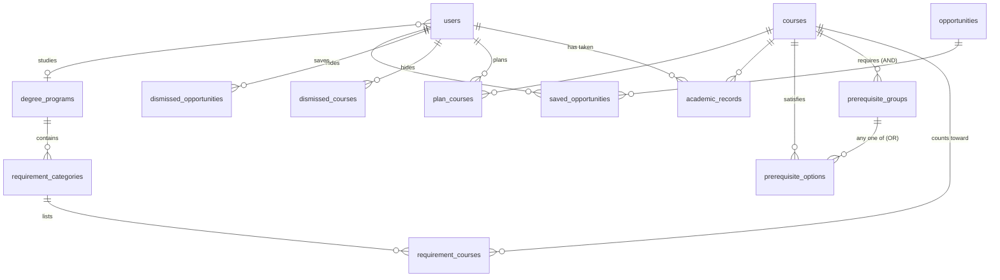

# Database

PostgreSQL through Prisma 7. Schema: `backend/prisma/schema.prisma`. Migrations: `backend/prisma/migrations/`.

## Setup

```bash
createdb sync_dev && createdb sync_test   # once
cd backend
cp .env.example .env                      # set DATABASE_URL and TEST_DATABASE_URL
npm install                               # also generates the Prisma client
npx prisma migrate dev                    # creates the tables
npm run db:seed                           # sample catalog + demo accounts
npm run dev                               # http://localhost:5001
```

Demo logins, all with password `password123`: `mike.smith@gsu.edu` (a senior with a full record and plan), `advisor@gsu.edu`, `admin@gsu.edu`. New accounts made with "Create account" start with an empty record.

| Script | What it does |
|---|---|
| `npm run db:migrate` | Apply schema changes and create a new migration |
| `npm run db:seed` | Reload the sample catalog and reset the demo accounts (other users are untouched) |
| `npm run db:reset` | Drop everything, re-run migrations, and seed |
| `npm run db:studio` | Browse the data in Prisma Studio |
| `npm test` | Empties and re-seeds `sync_test`, then runs every test |

## Design

Two kinds of data:

- **Catalog**, shared by everyone and changed only by admins: courses, prerequisites, degree programs, opportunities.
- **Student data**, owned by one user: their record, plan, preferences, dismissals and saves. Every row has a `userId` that cascades on delete, so deleting an account removes all of its data (FR-1.3).



| Table | Holds | Key points |
|---|---|---|
| `users` | Account and student profile | `email` unique; `passwordHash` (bcrypt); `role`; program, goal, interests, credit limit, target graduation term |
| `courses` | Catalog courses | Primary key is the course code (`CSC 4520`); `termsOffered`, `tags` |
| `prerequisite_groups` / `prerequisite_options` | Prerequisites as AND-of-ORs | `CSC 4850` needs `CSC 4520` AND (`MATH 3020` OR `MATH 4751`) = two groups. `concurrentAllowed` marks a corequisite |
| `degree_programs` | Programs | `totalCredits` (120) |
| `requirement_categories` / `requirement_courses` | Requirements | `ALL_OF` (every course) or `CREDITS_FROM` (N credits from a list, for electives). `position` sets display order and the order courses are counted in |
| `academic_records` | Completed and in-progress courses | One row per student per course; term is optional (null = transfer credit) |
| `plan_courses` | The degree plan | One row per student per course, with the term it's planned for |
| `dismissed_courses` / `dismissed_opportunities` | "Not interested" | Composite primary key (`userId`, item) |
| `opportunities` / `saved_opportunities` | Post-grad options and experiences; a student's saved ones | Saves carry `status` (saved, applied, accepted, rejected) and `notes` for application tracking (FR-10.3) |

### Decisions

| Decision | Why |
|---|---|
| Course code as the primary key | Codes are what students, the catalog, and every service use. `onUpdate: Cascade` keeps references correct if a code is renamed |
| Prerequisites as groups and options, not a single edge table | A plain edge table can't express "A or B". Groups make AND/OR exact and still form a graph for cycle checks |
| Profile fields on `users` | Each student has exactly one profile, so a separate table would only add a join |
| One plan per student | Simple to build and use. Multiple named plans (FR-6.1) would add a `degree_plans` table between `users` and `plan_courses` |
| Derived values are never stored | Credits, progress, expected graduation, recommendations, and prerequisite conflicts are calculated on each request from the rows above, so they can't go stale |
| Catalog cached in memory | It's the same for every request; the cache is cleared after an admin import |
| Catalog rows can't be deleted while students reference them | Prerequisite, requirement, and record links use `Restrict`, so a course that's still in use can't disappear |

## How the app uses it

1. **Log in / sign up** (`/api/auth/*`): checks the bcrypt hash and returns a JWT holding the user's id and role. The frontend stores it as `sync_token` and sends it on every request.
2. **Every student request** (`/api/<feature>/me/...`): `middleware/student-access.ts` loads that user's snapshot (record, plan, preferences, dismissals, saves) in one query. Students can only reach their own data; advisors and admins can read but not change it.
3. **Pages**: the dashboard, Recommendations, and Timeline load from `/api/progress/me`, `/api/recommendations/me`, and `/api/plans/me`. "Add to plan", goal and interest changes, "Not interested", and "Save" write to the database, so they're there on the next login, on any device.
